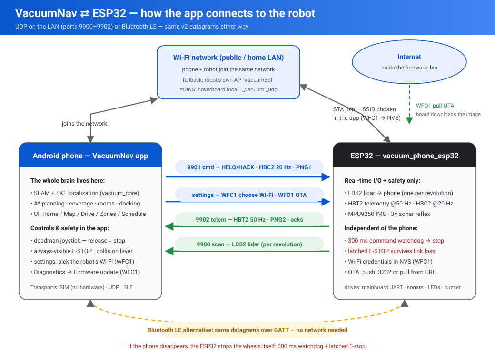
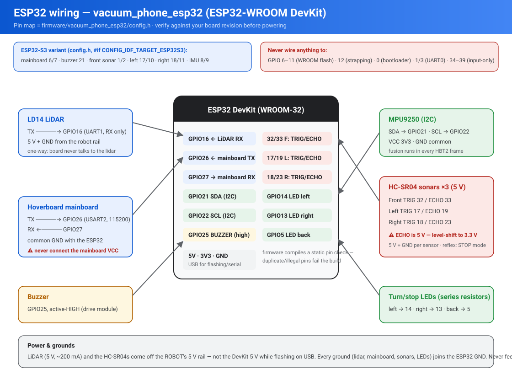
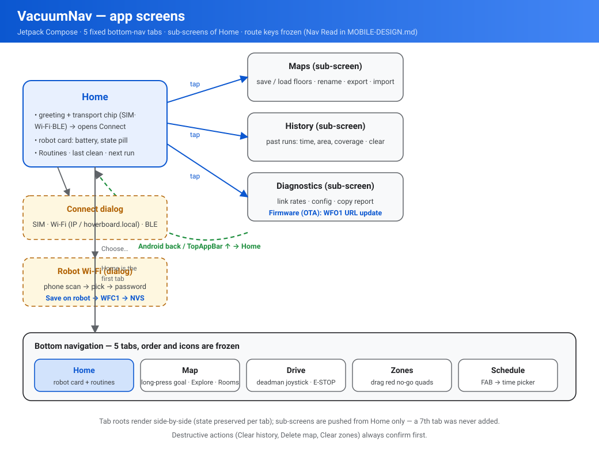

# VacuumNav — an Android robot-vacuum brain (no ROS, no PC)

The **phone is the robot's entire brain**: SLAM, localization, planning, coverage
and the UI all run in an Android app. The **ESP32** does only real-time I/O and
safety: lidar streaming, telemetry, sonar reflex, wheel commands — and it stops
the wheels **by itself** if the phone ever disappears. No ROS, no
Raspberry Pi, no laptop on the robot.

<p align="center">
  
</p>

## Contents

- [System at a glance](#system-at-a-glance)
- [Operating guide](#operating-guide) — wire → flash → connect → clean
- [App screens](#app-screens)
- [ESP32 wiring](#esp32-wiring)
- [Ports & transports](#ports--transports)
- [Safety model](#safety-model)
- [Firmware updates (OTA)](#firmware-updates-ota)
- [Building & testing](#building--testing)
- [Repository layout](#repository-layout)
- [Documentation](#documentation)

---

## System at a glance

| Layer | Where | Role |
|---|---|---|
| **VacuumNav app** | `android/VacuumNav/` (Kotlin + Jetpack Compose) | UI, transports (SIM / UDP / BLE), foreground service with a 20 Hz control loop, JNI bridge |
| **vacuum_core** | `vacuum_core/` (C++17, built by the app's NDK/CMake) | 2-D SLAM (log-odds grid + correlative scan matcher), pose-graph mapper, EKF, tempered MCL, costmaps, A*, pure-pursuit go-to, frontier exploration, room segmentation, boustrophedon coverage, physics simulator |
| **ESP32 firmware** | `firmware/vacuum_phone_esp32/` (Arduino, ESP32 core 4.0.0) | LDS2 lidar stream, HBT2 telemetry, HBC2 wheel commands, sonar reflex, IMU, lights/buzzer, Wi-Fi provisioning, OTA — **and all of the safety** |
| **Wire protocol** | `docs/PROTOCOL.md` | v2 datagrams over UDP (9900–9902) or Bluetooth LE; v1 documented for reference |

Hardware: one **ESP32 DevKit** (WROOM-32 or S3), a **YDLIDAR LD14** serial lidar,
an **MPU9250** IMU, three **HC-SR04** sonars, and a hoverboard mainboard driving
the wheels over USART2 (the mainboard's own timeout is the last line of defence).

---

## Operating guide

### 1. One-time: wire and flash the ESP32

<p align="center">
  
</p>

Checklist (full pin maps live in `firmware/vacuum_phone_esp32/config.h`):

1. **Common ground everywhere** — lidar, mainboard, all three sonars, LEDs.
2. Power the **lidar (5 V) and sonars (5 V) from the robot's 5 V rail**, not the
   DevKit's 5 V while flashing over USB. **Never connect the mainboard's VCC.**
3. HC-SR04 **ECHO is 5 V — level-shift to 3.3 V** before the ESP32.
4. Leave GPIO 6–11 (WROOM flash), 12, 0, 1/3 and 34–39 unwired.

Then create your secrets (git-ignored — never committed) and flash:

```bash
# ESP32 core (once) + credentials (once)
arduino-cli core install esp32:esp32 \
  --additional-urls https://espressif.github.io/arduino-esp32/package_esp32_index.json
cp firmware/vacuum_phone_esp32/secrets.h.example firmware/vacuum_phone_esp32/secrets.h
# edit secrets.h: set OTA_PASSWORD (required for any OTA); WIFI_SSID/PASS are
# only the first-boot default — the app can change the network at runtime.

# build + upload over USB
arduino-cli compile --fqbn esp32:esp32:esp32  firmware/vacuum_phone_esp32   # WROOM
arduino-cli upload  -p /dev/tty.usbserial-XXX --fqbn esp32:esp32:esp32 firmware/vacuum_phone_esp32
# for the S3 use FQBN esp32:esp32:esp32s3 (different pin map)
```

**First boot behaviour:** `STA_FALLBACK` mode — the board joins the network from
`secrets.h`/NVS; if it can't within 20 s it opens its own access point
**`VacuumBot`** (password `vacuumbot`) so you can always reach it. It
announces itself via mDNS as **`hoverboard.local`** (`_vacuum._udp`).

### 2. Build the app and connect

```bash
cd android/VacuumNav
./gradlew :app:assembleDebug     # build the APK
./gradlew :app:installDebug      # …or build + install to the plugged phone
./gradlew :app:testDebugUnitTest # JVM tests (39)
```

Open **VacuumNav** → tap the **transport chip** (top-right of Home) →
*Connect to robot*:

| Transport | When to use | What to enter |
|---|---|---|
| **SIM** | No hardware at all — full simulator | nothing |
| **Wi-Fi** | Board and phone on the same network | board IP or `hoverboard.local` |
| **BLE** | No network yet, or a crowded/isolated one | pick the board from the scan list (~10 m) |

**Put the robot on your network (public/home Wi-Fi):** in the same Connect
dialog → **Robot Wi-Fi network → Choose…** → the *phone* scans nearby networks
→ pick one, type its password → **Save on robot**. The app sends `WFC1` over
the current link (UDP *or* BLE), the ESP32 stores it in **NVS** and joins —
credentials survive reboots and firmware updates. Wrong password? The board
fails to join, re-opens its own `VacuumBot` AP after 20 s, and you simply try
again.

### 3. Run a clean

<p align="center">
  
</p>

| Screen | What it does | Key gestures |
|---|---|---|
| **Home** | Battery, state pill, last clean, next schedule, routines | transport chip → Connect; gear → Diagnostics |
| **Map** | Live SLAM map, right rail (Zones, Drive, Save, Explore, Grid, 2D/3D), Full/Rooms/Zones modes, **Start/Pause · Dock · E-STOP** | **long-press the map** = drive there; Rooms: tap room chips to target, rename/merge |
| **Drive** | Manual/Avoid/Follow lidar behaviours, obstacle banner + buzzer, speed slider, sonar chips, dock controls, big E-STOP | **hold the joystick — release = stop** (deadman) |
| **Zones** | Isometric no-go editor (red quads) | drag body to move, corner to resize, per-zone switch, **Save** |
| **Schedule** | Cleaning/Routines groups, exact alarms + boot re-arm | **+** FAB → time picker; toggle rows |
| **Maps** | Save/load floors (load also feeds the nav costmap), rename, export/import | Delete asks for confirmation |
| **History** | Past runs: time, duration, area, coverage % | Clear asks for confirmation |
| **Diagnostics** | Link rates/ages, battery, sonar, ticks, config, copyable report → **Firmware (OTA)** | — |

The bottom navigation is **five fixed tabs** (Home · Map · Drive · Zones ·
Schedule); Maps/History/Diagnostics are pushed from Home and Android back pops
them to Home (Nav Read: `docs/MOBILE-DESIGN.md`).

### 4. Stop it, really

- **E-STOP** is always visible (Home card, Map, Drive). On the board it
  **latches**: cleared only by the owner.
- The joystick is **deadman** — the robot never rolls after your finger lifts.
- Losing the link (telemetry/lidar timeout) → the app banners **Robot link
  lost** and zeroes RPM; the board's own 300 ms watchdog stops the wheels even
  if the app died completely.

---

## Ports & transports

UDP (little-endian, one datagram per message; exact byte tables in
[`docs/PROTOCOL.md`](docs/PROTOCOL.md)):

| Port | Direction | Carries |
|---|---|---|
| **9900** | board → phone | `LDS2` lidar scan (one datagram per revolution, 1106 B) |
| **9901** | phone → board (replies return here) | `HELO`/`HACK` claim · `HBC2` wheel commands @20 Hz · `PNG1` keepalive · `BYE1` release · `WFC1` choose Wi-Fi · `WFO1` firmware URL |
| **9902** | board → phone | `HBT2` telemetry @50 Hz · `PNG2` clock sync · `WFCA`/`WFOA`/`WFOB` replies |

**Bluetooth LE** carries *the same datagrams* over one GATT service
(write = command, notify = reply, MTU 517 — FriendBot-compatible UUIDs), so
provisioning, driving and OTA all work with **no network at all**. Ownership is
a single-owner **lease**: the first `HELO` claims the board, a second phone must
explicitly take over.

---

## Safety model

Design rule: **the phone may be slow, asleep, ringing or gone — the board is
never allowed to keep driving.**

**On the ESP32 (always active, no phone required):**

1. **300 ms command watchdog** — no `HBC2` within 300 ms → wheels zero (the
   mainboard repeats this at 800 ms as the last resort).
2. **Latched E-stop** — set by `HBC2`, survives lease expiry; every source
   (app, web stick, reflex) is held at zero until the owner clears it.
3. **Sonar reflex** — default `STOP` mode strips the forward component while an
   obstacle is inside the stop distance, independent of the app.
4. **Battery protection** — low pack scales speed down, critical stops.
5. **OTA gates** — firmware is only accepted from the owner, only with the
   `OTA_PASSWORD`, only while the robot stands still; wheels are held at zero
   from the first byte to the reboot.

**On the phone (in front of every command source):**

6. **Collision layer** — bumper polygons: inside the stop zone → 0, inside the
   slow zone → 40 % speed. The joystick and auto-clean both go through it.
7. **Deadman joystick** — release = stop.
8. **Link timeouts** — no telemetry / no lidar → zero RPM + red banner.

---

## Firmware updates (OTA)

| Path | Use when | How |
|---|---|---|
| **LAN push** (ArduinoOTA, port 3232) | your computer and the robot share a trusted network | `tools/ota_upload.sh [sketch-dir] <host-or-ip> [fqbn]` — compiles, then pushes with the `secrets.h` password. The robot must stand still. |
| **URL pull** (`WFO1`, from the app) | the board has internet; no computer needed | Diagnostics → **Firmware (OTA)** → paste a URL to a `.ino.bin` + the OTA password → **Update firmware**. The board downloads it itself, replies `WFOB`, and reboots into the new image. |

Notes: the sketch currently occupies **94–95 % of the dual-slot 1.3 MB OTA
partition scheme** — keep that scheme (the second slot is what makes OTA safe).
`https://` downloads encrypt but don't pin CAs; on an untrusted LAN prefer the
password-authenticated LAN push. Details: `docs/ASSUMPTIONS.md` §10 and
`docs/PROTOCOL.md` §3.10.

---

## Building & testing

```bash
# Android app: APK + JVM tests (39)
cd android/VacuumNav && ./gradlew :app:assembleDebug :app:testDebugUnitTest

# C++ core: host unit tests (57) via GoogleTest
cmake -S vacuum_core -B build -DVACUUM_BUILD_TESTS=ON
cmake --build build && ctest --test-dir build

# ESP32 firmware: both boards must compile clean
arduino-cli compile --fqbn esp32:esp32:esp32  firmware/vacuum_phone_esp32   # WROOM: 95 % flash
arduino-cli compile --fqbn esp32:esp32:esp32s3 firmware/vacuum_phone_esp32  # S3:    94 % flash

# Bench without any hardware: a Python stand-in board for protocol v2
python3 tools/phone_sim.py --help
```

macOS-on-exFAT quirks (AppleDouble sidecars, Xcode licence gate, relocated
build dirs) are handled automatically — see `docs/ASSUMPTIONS.md` §9.

---

## Repository layout

```
android/VacuumNav/     Android app (Compose UI, RobotService, transports, JNI)
vacuum_core/           C++17 SLAM/navigation library + 57 host tests
firmware/vacuum_phone_esp32/   ESP32 sketch (config.h = the only file you edit)
tools/                 phone_sim.py (virtual board), ota_upload.sh (LAN OTA)
docs/                  PROTOCOL · ARCHITECTURE · ASSUMPTIONS · MOBILE-DESIGN + diagrams
```

## Documentation

| Doc | What's in it |
|---|---|
| [`docs/PROTOCOL.md`](docs/PROTOCOL.md) | every packet, byte by byte (v1 + v2, UDP + BLE, WFC1/WFO1) |
| [`docs/ARCHITECTURE.md`](docs/ARCHITECTURE.md) | module map, frames (map → odom → base → laser) |
| [`docs/ASSUMPTIONS.md`](docs/ASSUMPTIONS.md) | decisions, trust models, dev-machine build facts |
| [`docs/MOBILE-DESIGN.md`](docs/MOBILE-DESIGN.md) | design tokens, Nav Read, regression greps |

Firmware behaviour and history: [`firmware/vacuum_phone_esp32/CHANGELOG.md`](firmware/vacuum_phone_esp32/CHANGELOG.md).
